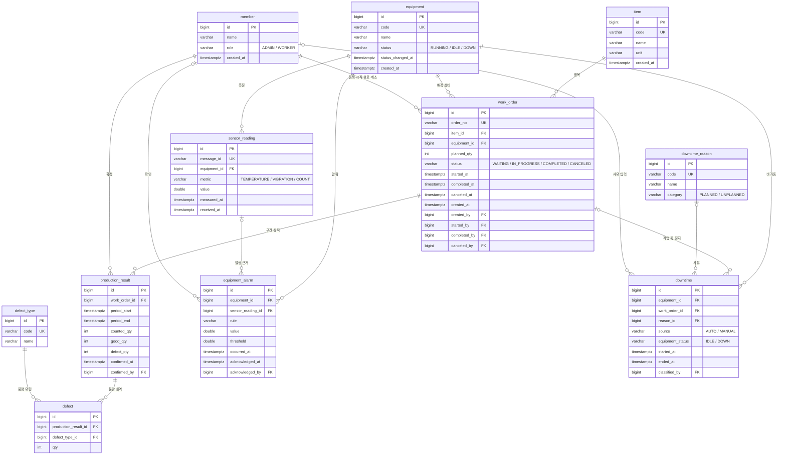

# ERD · 테이블 정의서

- 기준 스키마: Flyway `V1__init.sql` ~ `V3__work_order_actors.sql` (PostgreSQL 16)
- 스키마의 원본은 `mes-server/src/main/resources/db/migration`이다. 마이그레이션을 추가하면 **같은 PR에서 이 문서도 고친다.**
- 괄호 안 규칙 번호(W1, P3 …)는 [비즈니스 규칙](business-rules.md) 문서를 따른다.

## 1. ERD

## 2. 테이블 목록

| 영역 | 테이블 | 설명 |
| --- | --- | --- |
| 기준 정보 | `equipment` | 설비 마스터. 상태는 설비 상태 신호로만 바뀐다 |
| | `item` | 품목 마스터 |
| | `member` | 사용자와 역할 (관리자 / 작업자). 인증 없이 식별만 한다 |
| | `defect_type` | 불량 유형 코드 |
| | `downtime_reason` | 비가동 사유 코드 (계획 / 비계획) |
| 생산 | `work_order` | 작업지시. 1건 = 설비 1대 |
| | `production_result` | 작업지시의 구간별 생산 실적. 확정 시점에 생성 |
| | `defect` | 실적별 불량 내역 |
| 설비 데이터 | `sensor_reading` | 설비 측정값. 세로형(metric + value) 저장 |
| | `equipment_alarm` | 측정값 규칙 위반으로 생긴 설비 이상 알람 |
| | `downtime` | 비가동 이력. 설비가 RUNNING이 아닌 모든 구간 |

## 3. 테이블 상세

공통 규칙
- PK는 모두 `bigint GENERATED ALWAYS AS IDENTITY`
- 시각은 모두 `timestamptz` (애플리케이션은 `Instant`)
- 상태값은 `varchar` + `CHECK` (JPA `@Enumerated(EnumType.STRING)`과 일치)
- 처리자 컬럼(`*_by`)은 `member.id`를 참조한다

### equipment

| 컬럼 | 타입 | NULL | 설명 |
| --- | --- | --- | --- |
| id | bigint | N | PK |
| code | varchar(30) | N | 설비 코드, UNIQUE |
| name | varchar(100) | N | 설비명 |
| status | varchar(20) | N | `RUNNING` / `IDLE` / `DOWN`, 기본 `IDLE` |
| status_changed_at | timestamptz | N | 마지막 상태 변경 시각. 이보다 오래된 상태 메시지는 무시 (T3) |
| created_at | timestamptz | N | 등록 시각 |

### item

| 컬럼 | 타입 | NULL | 설명 |
| --- | --- | --- | --- |
| id | bigint | N | PK |
| code | varchar(30) | N | 품목 코드, UNIQUE |
| name | varchar(100) | N | 품목명 |
| unit | varchar(10) | N | 단위, 기본 `EA` |
| created_at | timestamptz | N | 등록 시각 |

### member

| 컬럼 | 타입 | NULL | 설명 |
| --- | --- | --- | --- |
| id | bigint | N | PK. API 요청 헤더 `X-Member-Id`로 전달 |
| name | varchar(50) | N | 이름 |
| role | varchar(20) | N | `ADMIN` / `WORKER` |
| created_at | timestamptz | N | 등록 시각 |

### work_order

| 컬럼 | 타입 | NULL | 설명 |
| --- | --- | --- | --- |
| id | bigint | N | PK |
| order_no | varchar(30) | N | 작업지시 번호, UNIQUE |
| item_id | bigint | N | FK → item |
| equipment_id | bigint | N | FK → equipment |
| planned_qty | int | N | 계획 수량, 1 이상 (W4) |
| status | varchar(20) | N | `WAITING` / `IN_PROGRESS` / `COMPLETED` / `CANCELED` |
| started_at / started_by | timestamptz / bigint | Y | 시작 시각과 시작한 작업자. 함께 기록 (R3) |
| completed_at / completed_by | timestamptz / bigint | Y | 완료 시각(마지막 확정 실적 구간의 끝)과 완료한 작업자 (P6, R3) |
| canceled_at / canceled_by | timestamptz / bigint | Y | 취소 시각과 취소한 관리자. `CANCELED`에서만 값이 있음 |
| created_at | timestamptz | N | 등록 시각 |
| created_by | bigint | N | 등록한 관리자 (R3) |

제약 · 인덱스
- `ux_work_order_equipment_in_progress`: `status = 'IN_PROGRESS'`인 행의 `equipment_id` 부분 유니크 인덱스. 설비당 진행 중 작업지시 1건 (W1)
- `ck_work_order_started_at`: 진행 중·완료 상태면 `started_at` 필수
- `ck_work_order_completed_at`: `COMPLETED`일 때만 `completed_at`, 시작 이후
- `ck_work_order_started_by`, `ck_work_order_completed_by`, `ck_work_order_canceled`: 시각과 처리자는 함께 기록
- `ix_work_order_status`, `ix_work_order_created_by`

### production_result

| 컬럼 | 타입 | NULL | 설명 |
| --- | --- | --- | --- |
| id | bigint | N | PK |
| work_order_id | bigint | N | FK → work_order |
| period_start | timestamptz | N | 실적 구간 시작. 첫 구간은 작업 시작 시각, 이후는 직전 구간의 끝 (P2) |
| period_end | timestamptz | N | 실적 구간 끝. 시작보다 뒤, 미래 불가 (P3) |
| counted_qty | int | N | 구간 내 센서 COUNT 합계. 서버가 계산 (P4) |
| good_qty | int | N | 양품 수량, 0 이상 (P5) |
| defect_qty | int | N | 불량 수량, 0 이상 (P5). 불량 내역 합계와 같음 (D1) |
| confirmed_at | timestamptz | N | 확정 시각. 확정 시점에 생성되고 이후 수정 불가 (P7) |
| confirmed_by | bigint | N | 확정한 작업자 (R3) |

제약 · 인덱스
- `uk_production_result_period`: `(work_order_id, period_start)` UNIQUE. 같은 구간 동시 등록 이중 방어 (P2)
- `ix_production_result_confirmed_by`

### defect_type

| 컬럼 | 타입 | NULL | 설명 |
| --- | --- | --- | --- |
| id | bigint | N | PK |
| code | varchar(30) | N | 불량 코드, UNIQUE |
| name | varchar(100) | N | 불량명 |

기준 데이터: `DIMENSION` 치수 불량, `APPEARANCE` 외관 불량, `CRACK` 크랙, `CONTAMINATION` 이물

### defect

| 컬럼 | 타입 | NULL | 설명 |
| --- | --- | --- | --- |
| id | bigint | N | PK |
| production_result_id | bigint | N | FK → production_result |
| defect_type_id | bigint | N | FK → defect_type |
| qty | int | N | 불량 수량, 1 이상 (D2) |

제약: `uk_defect_result_type` `(production_result_id, defect_type_id)` UNIQUE. 한 실적 안에서 같은 유형은 한 줄로 합산

### sensor_reading

| 컬럼 | 타입 | NULL | 설명 |
| --- | --- | --- | --- |
| id | bigint | N | PK |
| message_id | varchar(64) | N | 시뮬레이터가 붙인 메시지 ID, UNIQUE. 중복 수신 방지 (S1) |
| equipment_id | bigint | N | FK → equipment |
| metric | varchar(20) | N | `TEMPERATURE` / `VIBRATION` / `COUNT` |
| value | double precision | N | 측정값 |
| measured_at | timestamptz | N | 설비 측정 시각 |
| received_at | timestamptz | N | 서버 수신 시각 |

인덱스: `ix_sensor_reading_equipment_metric_time` `(equipment_id, metric, measured_at)`. 설비·항목별 최근 값 조회, 구간 COUNT 합계 조회 (P4)

### equipment_alarm

| 컬럼 | 타입 | NULL | 설명 |
| --- | --- | --- | --- |
| id | bigint | N | PK |
| equipment_id | bigint | N | FK → equipment |
| sensor_reading_id | bigint | Y | FK → sensor_reading. 알람을 일으킨 측정값 |
| rule | varchar(50) | N | 위반한 감지 규칙 |
| value | double precision | N | 위반 당시 값 |
| threshold | double precision | N | 기준값 |
| occurred_at | timestamptz | N | 발생 시각 |
| acknowledged_at / acknowledged_by | timestamptz / bigint | Y | 확인 시각과 확인한 관리자. 함께 기록 (R3) |

제약 · 인덱스
- `ux_equipment_alarm_open`: `acknowledged_at IS NULL`인 행의 `(equipment_id, rule)` 부분 유니크 인덱스. 확인 전 같은 알람 중복 생성 방지 (A1)
- `ck_equipment_alarm_ack`: 확인 시각은 발생 시각 이후

### downtime_reason

| 컬럼 | 타입 | NULL | 설명 |
| --- | --- | --- | --- |
| id | bigint | N | PK |
| code | varchar(30) | N | 사유 코드, UNIQUE |
| name | varchar(100) | N | 사유명 |
| category | varchar(20) | N | `PLANNED`(계획 정지) / `UNPLANNED`(비계획 정지) |

기준 데이터

| category | code | name |
| --- | --- | --- |
| PLANNED | NO_ORDER | 작업 없음 |
| PLANNED | BREAK | 휴식·식사 |
| PLANNED | PLANNED_MAINT | 계획 보전 |
| UNPLANNED | BREAKDOWN | 설비 고장 |
| UNPLANNED | MATERIAL_WAIT | 자재 대기 |
| UNPLANNED | QUALITY_WAIT | 품질 확인 대기 |
| UNPLANNED | CHANGEOVER | 금형·품목 교체 |
| UNPLANNED | NO_OPERATOR | 작업자 부재 |

### downtime

| 컬럼 | 타입 | NULL | 설명 |
| --- | --- | --- | --- |
| id | bigint | N | PK |
| equipment_id | bigint | N | FK → equipment |
| work_order_id | bigint | Y | FK → work_order. NULL이면 작업 없는 정지 |
| reason_id | bigint | Y | FK → downtime_reason. NULL이면 미분류 |
| source | varchar(10) | N | `AUTO`(자동 분류) / `MANUAL`(사람이 입력) |
| equipment_status | varchar(20) | N | 정지 당시 설비 상태 `IDLE` / `DOWN` |
| started_at | timestamptz | N | 정지 시작 |
| ended_at | timestamptz | Y | 정지 종료. NULL이면 진행 중. 시작 이후 (T2) |
| classified_by | bigint | Y | 사유를 입력한 사람. 자동 분류·미분류면 NULL (R3) |

제약 · 인덱스
- `ux_downtime_equipment_open`: `ended_at IS NULL`인 행의 `equipment_id` 부분 유니크 인덱스. 설비당 진행 중 비가동 1건 (T1)
- `ix_downtime_equipment_started` `(equipment_id, started_at)`: 기간별 비가동 집계
- `ix_downtime_work_order`: 작업지시별 비가동 조회

## 4. 마이그레이션 이력

| 버전 | 파일 | 내용 |
| --- | --- | --- |
| V1 | `V1__init.sql` | 초기 스키마 10개 테이블, 기준 데이터(비가동 사유, 불량 유형) |
| V2 | `V2__member.sql` | `member` 테이블, 등록·확정·확인·사유 입력 처리자 컬럼 |
| V3 | `V3__work_order_actors.sql` | 작업지시 시작·완료·취소 처리자와 취소 시각 |
