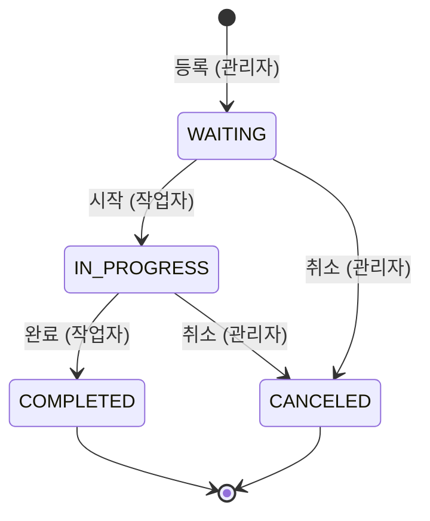

# 상태 전이 · 비즈니스 규칙

코드 주석, 에러 메시지, 테스트 이름에 나오는 규칙 번호(W1, P3 …)의 원본 문서입니다.
규칙을 바꾸면 **이 문서, 코드, 테스트를 같은 PR에서 함께 고칩니다.**

## 규칙을 지키는 위치

| 위치 | 맡는 규칙 | 예 |
| --- | --- | --- |
| DB 제약 | 한 테이블 안에서 판단할 수 있는 규칙 | 설비당 진행 중 작업지시 1건 (W1) |
| 엔티티 메서드 | 상태 전이와 그 조건 | DOWN 설비는 작업 시작 불가 (W2) |
| 서비스 트랜잭션 | 여러 테이블에 걸친 규칙 | 실적 구간 연속성 (P2) |

각 규칙은 테스트로 검증합니다. 테스트의 `@DisplayName`은 규칙 번호로 시작합니다.

---

## 1. 상태 전이

### 상태를 가진 테이블

| 테이블.컬럼 | 상태 값 | 누가 바꾸나 |
| --- | --- | --- |
| `work_order.status` | WAITING / IN_PROGRESS / COMPLETED / CANCELED | 작업자·관리자 (API 요청) |
| `equipment.status` | RUNNING / IDLE / DOWN | 설비 상태 신호 (시뮬레이터, 현장에서는 PLC·SCADA) |
| `downtime.ended_at` | NULL(진행 중) / 값 있음(종료) | 위 두 상태 변화에 따라 자동 |

### 작업지시 (`work_order.status`)

| 전이 | 누가 | 조건 | 함께 변경되는 데이터 |
| --- | --- | --- | --- |
| WAITING → IN_PROGRESS | 작업자 | 그 설비에 진행 중인 작업지시가 없고 (W1), 설비가 DOWN이 아님 (W2) | `started_at`·`started_by` 기록. 설비가 RUNNING이 아니면 진행 중인 "작업 없음" 비가동을 닫고, 이 작업지시에 연결된 새 비가동을 연다 |
| IN_PROGRESS → COMPLETED | 작업자 | 마지막 구간 실적까지 확정됨 (P6) | `completed_at`·`completed_by` 기록. 연결된 진행 중 비가동이 있으면 닫고 "작업 없음"으로 새로 연다 |
| WAITING → CANCELED | 관리자 | 없음 | `canceled_at`·`canceled_by` 기록 |
| IN_PROGRESS → CANCELED | 관리자 | 없음 | `canceled_at`·`canceled_by` 기록. 확정된 실적은 남긴다. 진행 중 비가동 처리는 COMPLETED와 같다 |

- 설비가 멈춰도 작업지시는 IN_PROGRESS를 유지하고, 멈춘 시간은 비가동으로만 기록한다.
- COMPLETED, CANCELED는 종료 상태로 되돌릴 수 없다 (W3).

### 설비 (`equipment.status`)

| 상태 | 의미 |
| --- | --- |
| RUNNING | 가동 중 |
| IDLE | 가동 가능하지만 생산하지 않음 |
| DOWN | 고장·정지 |

| 전이 | 트리거 | 함께 변경되는 데이터 |
| --- | --- | --- |
| RUNNING → IDLE / DOWN | 설비 상태 신호 | 비가동 생성 (`source = AUTO`). 진행 중 작업지시가 있으면 연결하고 사유는 미분류. 없으면 IDLE은 "작업 없음", DOWN은 미분류 (T4) |
| IDLE / DOWN → RUNNING | 설비 상태 신호 | 진행 중 비가동의 `ended_at` 기록 |
| IDLE ↔ DOWN | 설비 상태 신호 | 진행 중 비가동을 닫고 새로 연다 (정지 성격이 달라 구간 분리). 새 구간의 작업지시 연결·사유는 첫 줄과 같은 규칙 |

- 같은 상태가 다시 오면 무시한다.
- 설비의 마지막 상태 시각보다 오래된 메시지는 무시한다 (T3).

### 비가동 기록 원칙

- RUNNING이 아닌 모든 구간(IDLE, DOWN)을 비가동으로 기록하고, 사유로 분류한다.
- 작업지시 등록은 설비 상태와 관계없이 허용한다. 설비가 DOWN이면 등록 화면에 현재 정지 사유를 경고로 보여주고, 시작은 W2가 막는다.
- 가동률 계산 시 계획 정지(PLANNED)는 계획 가동 시간에서 빼고, 비계획 정지(UNPLANNED)만 손실로 계산한다.

---

## 2. 비즈니스 규칙

### 작업지시 (W)

| # | 규칙 | 보장 위치 |
| --- | --- | --- |
| W1 | 설비당 진행 중(IN_PROGRESS) 작업지시는 1건만 | DB 부분 유니크 인덱스 |
| W2 | 설비가 DOWN이면 작업 시작 불가 | 엔티티 / 서비스 |
| W3 | 정해진 전이 경로만 허용, COMPLETED·CANCELED는 되돌릴 수 없음 | 엔티티 메서드 |
| W4 | 계획 수량은 1 이상 | DB CHECK + 엔티티 |

### 생산 실적 (P)

| # | 규칙 | 보장 위치 |
| --- | --- | --- |
| P1 | 진행 중인 작업지시에만 실적 등록 | 엔티티 / 서비스 |
| P2 | 구간 연속성: 첫 구간 시작 = 작업 시작 시각, 이후 = 직전 구간의 `period_end` | 서비스 (+ DB UNIQUE 이중 방어) |
| P3 | `period_end > period_start`, 미래 시각 불가 | DB CHECK + 서비스 |
| P4 | `counted_qty`는 서버가 구간 내 COUNT 합계(`measured_at` 기준)로 계산, 작업자 수정 불가 | 서비스 |
| P5 | `good_qty`, `defect_qty`는 0 이상 | DB CHECK |
| P6 | 작업 완료 시 마지막 구간까지 실적이 확정돼 있어야 함 | 엔티티 / 서비스 |
| P7 | 확정된 실적은 수정·삭제 불가 | 엔티티 (변경 메서드 없음) |
| P8 | 누적 양품이 계획 수량을 넘어도 등록은 허용하고 경고로 표시. 같은 작업지시에 동시 등록되지 않도록 작업지시 행 락 | 서비스 (`SELECT … FOR UPDATE`) |

### 불량 (D)

| # | 규칙 | 보장 위치 |
| --- | --- | --- |
| D1 | 불량 내역 qty 합계 = 실적의 `defect_qty` (실적과 같은 트랜잭션에서 등록) | 서비스 |
| D2 | 불량 내역 qty는 1 이상 | DB CHECK |

### 비가동 (T)

| # | 규칙 | 보장 위치 |
| --- | --- | --- |
| T1 | 설비당 진행 중(`ended_at IS NULL`) 비가동은 1건만 | DB 부분 유니크 인덱스 |
| T2 | `ended_at ≥ started_at` | DB CHECK + 엔티티 |
| T3 | 설비의 마지막 상태 시각보다 오래된 상태 메시지는 무시 (메시지 순서 뒤바뀜 대응) | 엔티티 (`Equipment.changeStatus`) |
| T4 | 작업 없이 멈춘 구간: IDLE은 "작업 없음" 자동 분류, DOWN은 미분류로 열고 관리자나 작업자가 사유 입력. 작업 중 정지의 사유는 작업자만 입력 (R2) | 엔티티 (`Downtime`) |

### 센서 · 알람 (S, A)

| # | 규칙 | 보장 위치 |
| --- | --- | --- |
| S1 | 같은 `message_id`는 한 번만 저장 | DB UNIQUE + `INSERT … ON CONFLICT DO NOTHING` |
| S2 | 등록되지 않은 설비 코드의 메시지는 거부 | 서비스 |
| A1 | 같은 설비·같은 규칙의 알람은 확인 전까지 중복 생성하지 않음 (알람 폭주 방지) | DB 부분 유니크 인덱스 |

### 역할 (R)

인증은 MVP 범위 밖입니다. 로그인 없이 요청 헤더 `X-Member-Id`로 사용자를 식별하고 `member.role`로 접근을 나눕니다.

| # | 규칙 | 보장 위치 |
| --- | --- | --- |
| R1 | 작업지시 등록·취소, 알람 확인은 관리자(ADMIN)만. 다른 역할이면 403 | 엔티티 (`Member.requireRole`) + API 경로 (`/api/admin/**`) |
| R2 | 작업 시작·완료, 실적 확정, 작업 중 비가동 사유 입력은 작업자(WORKER)만. 다른 역할이면 403 (작업 없는 DOWN 비가동은 관리자도 입력, T4) | 엔티티 (`Member.requireRole`, `Downtime.classify`) + API 경로 (`/api/worker/**`) |
| R3 | 처리자 기록: 등록·확정 시 `created_by`·`confirmed_by` 필수, 작업지시 시작·완료·취소는 시각과 처리자를 함께 기록, 알람은 `acknowledged_at`과 `acknowledged_by`를 함께 기록, 사유 입력 시 `classified_by` 기록 (자동 분류는 NULL) | DB NOT NULL·CHECK + 엔티티 |
