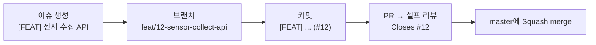

# Git Convention

## 1. 작업 흐름



- 기본 브랜치는 `master` 하나만 둡니다. 작업 브랜치에서 `master`로 바로 병합합니다.
- `master`는 항상 `./gradlew test`가 통과하는 상태로 유지합니다.
- 작은 문서 수정 외에는 `master`에 직접 커밋하지 않습니다.

## 2. 이슈

- 제목: `[TYPE] 작업 내용 요약`
- 예: `[FEAT] 센서 데이터 수집 API`, `[FIX] 늦게 도착한 상태 메시지가 비가동을 다시 여는 문제`
- 하루~이틀 안에 끝나는 단위로 나눕니다.
- 템플릿: Feature / Fix / Refactor / Docs ([`.github/ISSUE_TEMPLATE`](../.github/ISSUE_TEMPLATE))

## 3. 브랜치

`type/이슈번호-설명` (소문자, kebab-case)

```
feat/12-sensor-collect-api
fix/15-late-status-message
chore/10-spring-boot-4.1
```

## 4. 커밋 메시지

```
[TYPE] 제목 (#이슈번호)

본문 (선택) — 무엇을 왜 바꿨는지
```

| 태그 | 언제 |
| --- | --- |
| FEAT | 새 기능 추가, 기존 기능 변경 |
| FIX | 버그 수정 |
| REFACTOR | 동작 변화 없이 코드 구조 개선 |
| TEST | 테스트 추가·수정 (기능 코드 변경 없음) |
| DOCS | README, 주석, 문서 수정 |
| CHORE | 빌드·의존성·설정 변경 (Gradle, Docker, application.yml) |

- 태그는 대문자, 제목은 한글 50자 안팎, 끝에 마침표를 붙이지 않습니다.
- 제목은 "~ 추가", "~ 수정"처럼 무엇을 했는지로 끝냅니다.
- 커밋 하나에는 목적 하나만 담습니다. 기능 추가와 리팩토링을 섞지 않습니다.
- 본문에는 "왜"를 씁니다. 관련 규칙 번호가 있으면 적습니다.

✅ 좋은 예

```
[FEAT] 센서 수집 API에 message_id 중복 수신 방지 추가 (#12)

INSERT … ON CONFLICT DO NOTHING으로 중복 검사와 저장을 한 번에 처리 (규칙 S1)
```

```
[CHORE] Spring Boot 4.1로 버전 업그레이드 (#10)
```

❌ 나쁜 예: `12`, `수정`, `[FEAT] 수집 API 추가 및 엔티티 정리 및 테스트 수정`

## 5. PR

- 제목: 커밋 메시지와 같은 형식 `[TYPE] 작업 내용 요약`
- 본문에 `Closes #이슈번호`를 적어 병합 시 이슈를 자동으로 닫습니다.
- [PR 템플릿](../.github/pull_request_template.md)의 확인 항목을 채우고, Files changed 화면에서 셀프 리뷰한 뒤 병합합니다.
- 병합 방식: Squash and merge. `master`에는 PR 1개 = 커밋 1개로 남습니다.
- 병합한 브랜치는 삭제합니다.

## 6. 라벨

| 라벨 | 용도 |
| --- | --- |
| feat, fix, refactor, test, docs, chore | 작업 종류 (태그와 동일) |
| stage-2 ~ stage-6 | 개발 단계 |

## 7. DB 마이그레이션 (Flyway)

- 파일 이름: `V{번호}__{설명_snake_case}.sql` (예: `V4__sensor_reading_index.sql`)
- **한 번이라도 적용한 마이그레이션 파일은 수정하지 않습니다.** 바꿀 내용은 새 번호로 추가합니다. 수정하면 Flyway checksum 검증에 실패합니다.
- 마이그레이션을 추가하면 같은 PR에서 엔티티와 [ERD](ERD.md)를 함께 고치고, `:mes-server:bootRun`으로 Hibernate validate 통과를 확인합니다.
